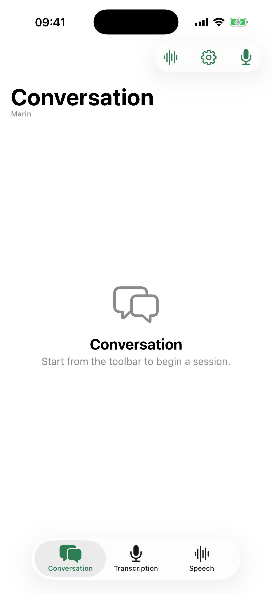
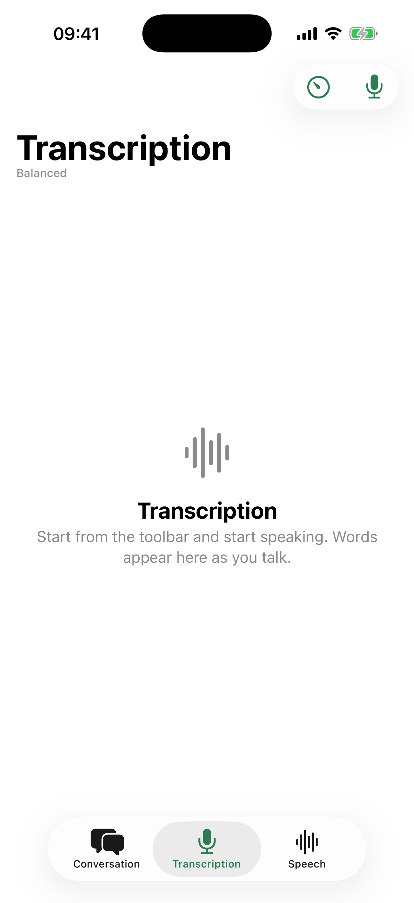
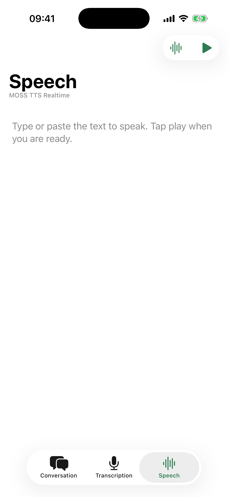

<div align="center">


# Wiro Realtime for Swift

**Official Swift / SwiftUI example for live voice AI on
[Wiro](https://wiro.ai) — speech-to-speech conversation, realtime
transcription, and text-to-speech**

[](https://github.com/wiroai/Swift-Realtime/actions/workflows/tests.yml)
[](https://swift.org)
[](#requirements)
[](LICENSE)

[Docs](https://wiro.ai/docs) · [Models](https://wiro.ai/models) ·
[Dashboard](https://wiro.ai/panel) ·
[Create Project](https://wiro.ai/panel/project/new)

</div>

## What's inside

Three realtime audio flows, each a tab in the app, each backed by a
live Wiro model over one WebSocket protocol:

| Flow | Model | What it does |
| --- | --- | --- |
| Conversation | [`openai/gpt-realtime-mini`](https://wiro.ai/models) | Full-duplex voice chat with barge-in |
| Transcription | [`mistralai/voxtral-mini-4b-realtime-2602`](https://wiro.ai/models) | Live speech-to-text as you talk |
| Speech | [`openmoss/moss-tts-realtime`](https://wiro.ai/models) | Streaming text-to-speech playback |

<div align="center">
<table>
  <tr>
    <td align="center"><b>Conversation</b></td>
    <td align="center"><b>Transcription</b></td>
    <td align="center"><b>Speech</b></td>
  </tr>
  <tr>
    <td></td>
    <td></td>
    <td></td>
  </tr>
</table>
</div>

The chrome is system SwiftUI: `TabView`, `NavigationStack`, toolbar
items, `Menu`, `Form`, `List`. Liquid Glass comes from iOS 26. There
is no custom orb, wave, or tab bar.

## Features

- Live speech-to-speech conversation with voice activity detection,
  barge-in, and a noise gate
- Realtime microphone transcription with streaming partial results
- Streaming text-to-speech with bounded PCM playback
- One `AVAudioEngine` graph for capture and playback, so the OS echo
  canceller (AEC) actually works
- Signed REST Run requests and the full Wiro realtime WebSocket
  protocol
- Bounded capture/playback queues, safe PCM overflow shedding, audio
  route and interruption handling
- Cross-feature guard so two tabs never hold the microphone at once
- Automatic reconnect to the same task on socket drops, with a
  bounded restart budget
- Session lifecycle covered by XCTest fakes — no device needed to
  verify the plumbing

## Requirements

- Xcode 26 or later
- A **physical** iPhone on iOS 26 — the simulator microphone is not
  a usable voice path
- A [Wiro project and API key](https://wiro.ai/panel/project/new)

No CocoaPods. The project is a single Xcode folder-synced target.

## Run

Copy the credential template and set the key:

```sh
cp Configs/Secrets.xcconfig.example Configs/Secrets.xcconfig
```

Edit `Configs/Secrets.xcconfig`:

```
WIRO_API_KEY = YOUR_API_KEY
WIRO_API_SECRET =
```

`WIRO_API_SECRET` is only for signature-based Wiro projects. Leave
it empty for API-key-only projects. The secrets file is gitignored.

Then:

```sh
open SwiftRealtime.xcodeproj
```

Select the **SwiftRealtime** scheme, pick a physical iPhone, and run.

Alternatively, leave the xcconfig empty and set `WIRO_API_KEY` (and
optionally `WIRO_API_SECRET`) on the scheme’s environment. Scheme
env wins over the compiled Info.plist values.

Launch fails fast when `WIRO_API_KEY` is missing.

> **Credentials warning:** values from `.xcconfig` are compiled into
> the binary and can be read out of any build you distribute. This
> is fine for a developer running the example on their own phone. It
> is not fine for an app in the App Store — see
> [Shipping to users](#shipping-to-users) before you do that.

## Shipping to users

The API key is only needed for one call: `POST /Run`, which creates
the task and returns a `socketaccesstoken`. Everything after that —
the WebSocket subscribe, the audio frames, the session end — is
authenticated by that per-task token alone. So the key never has to
leave your server.

The seam is the `WiroApiClient` protocol
([`SwiftRealtime/Networking/WiroApiClient.swift`](SwiftRealtime/Networking/WiroApiClient.swift)).
Implement it against your own backend, which holds the key, calls
`/Run` (and `/Task/Kill` for `terminateTaskBestEffort`), and hands
back the task id and token:

```swift
final class BrokeredWiroApiClient: WiroApiClient, @unchecked Sendable {
    func createCancellation() -> WiroRequestCancellation { .init() }

    func runModel(
        model: ModelDefinition,
        parameters: [String: Any],
        cancellation: WiroRequestCancellation?,
    ) async throws -> WiroRunResult {
        // POST to your server; it calls Wiro with the key and returns
        // { "taskId": ..., "taskToken": ... }.
    }

    func terminateTaskBestEffort(taskId: String, taskToken: String) async {
        // POST to your server; it calls /Task/Kill.
    }
}
```

Then build `RealtimeSessionDependencies` with it instead of the
credential-based convenience initializer:

```swift
RealtimeSessionDependencies(
    httpClient: URLSessionWiroHttpClient(),
    apiClient: BrokeredWiroApiClient(),
    readyTimeout: .seconds(15),
)
```

Nothing under `Realtime/` or `Audio/` changes: the socket client
only ever sees the task token. Your server decides who may start a
billed task, how many, and for how long — which is the control you
want over a metered resource anyway.

## Make it yours

[`SwiftRealtime/App/Config/ConversationConfig.swift`](SwiftRealtime/App/Config/ConversationConfig.swift)
holds the persona, the voice, and the model.
Editing that one file is the whole of turning this example into a
product.

```swift
static let persona = "...who the assistant is..."
static let voice = "marin"
```

Common changes:

- **Give the assistant a job** — rewrite `persona`.
- **Change the voice** — set `voice` to any option the model catalog
  lists.
- **Tune the engineering parameters** — `parameters` overrides the
  catalog defaults for turn detection, audio formats, and rates.
- **Ship only the conversation** — delete
  `SwiftRealtime/Views/Transcription/`,
  `SwiftRealtime/Views/Speech/`,
  `SwiftRealtime/Services/Transcription/`, and
  `SwiftRealtime/Services/Speech/` (plus their `Tests/` mirrors),
  then remove the two `Tab`s from
  `SwiftRealtime/Views/Home/RealtimeHomeView.swift`. Shared layers
  under `Models/`, `Networking/`, `Auth/`, `Realtime/`, and
  `Audio/` are untouched.

## How a conversation runs

```text
REST:      https://api.wiro.ai/v1
WebSocket: wss://socket.wiro.ai/v1
Run:       POST /Run/{owner}/{model}
```

1. `POST /Run/{owner}/{model}` returns a task id and a task token
   (`socketaccesstoken`).
2. A WebSocket opens and subscribes with
   `{ "type": "task_info", "tasktoken": "..." }`.
3. After `task_stream_ready`, 20 ms PCM chunks stream up as
   `UTF8(tasktoken + "|") + pcm_bytes`; audio frames come back in the
   same shape. Transcripts arrive as `task_output` messages prefixed
   `TRANSCRIPT_USER:` / `TRANSCRIPT_AI:`; `task_stream_end` marks the
   end of each assistant turn; `task_cost` reports `turnCost` and
   `cumulativeCost` as the conversation goes.
4. The app sends `task_session_end` on leave and gives the server a
   bounded window to answer with `task_postprocess_end` before it
   closes the socket. `task_end` alone only means the model process
   exited. A client that disconnects without `task_session_end` is
   cleaned up by the server, and so is a task whose wallet runs dry.

Audio is signed 16-bit PCM, 24 kHz, mono, little-endian on both
sides. Wiro's browser example sends 200 ms frames; this app sends
20 ms frames because barge-in latency is bounded by the frame size,
and the server accepts either.

Authentication is `x-api-key` alone, or `x-api-key` + `x-nonce` +
`x-signature` where the signature is
`HMAC-SHA256(key = API_KEY, message = API_SECRET + NONCE)`.

## Project layout

```text
SwiftRealtime/
  App/            entry, AppColors, ConversationConfig
  Models/         catalog, parameters, run result
  Networking/     HTTP, endpoints, Run launcher
  Auth/           credentials, nonce, headers
  Realtime/       socket, session, framing
  Audio/          PCM, engine, session
  Services/       Conversation / Transcription / Speech
  Views/          Home / Conversation / Transcription / Speech / Shared
Tests/            mirrors the app; Support/ holds fakes
Configs/
  Secrets.xcconfig.example   credential template (copy locally)
```

`Models/`, `Networking/`, `Auth/`, `Realtime/`, and `Audio/` have
no dependency on any view or screen service and cover the whole
Wiro integration — they are the part worth lifting into your own
app.

## Tests

```sh
WIRO_API_KEY=test xcodebuild test \
  -scheme SwiftRealtime \
  -destination 'platform=iOS Simulator,name=iPhone 17 Pro'
```

Tests mirror `SwiftRealtime/` and ship fakes for audio, network, and
the socket, so the entire session lifecycle runs without a device.
Time-dependent code takes a `RealtimeClock`; tests drive a
`TestClock` by hand, so no test waits on the wall.

CI (`.github/workflows/tests.yml`) runs the suite on an iOS 26
simulator plus `swiftformat --lint`, `swiftlint --strict`, and an
80-column check. See [`CONTRIBUTING.md`](CONTRIBUTING.md).

## Documentation

- [Wiro documentation](https://wiro.ai/docs)
- [Available models](https://wiro.ai/models)
- Same example on other platforms:
  [Dart / Flutter](https://github.com/wiroai/Dart-Realtime) ·
  [Kotlin](https://github.com/wiroai/Kotlin-Realtime) ·
  [React Native](https://github.com/wiroai/ReactNative-Realtime)

## License

MIT

---

<div align="center">


**Built with 💚 by the Wiro team**

[wiro.ai](https://wiro.ai) · [GitHub @wiroai](https://github.com/wiroai)

</div>
